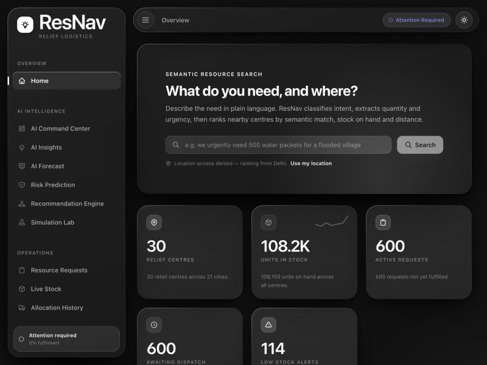

# ResNav

**Disaster-relief logistics where the database is the source of truth.**

React SPA → Flask JSON API → MySQL 8. Relief centres hold stock; disaster
zones raise requests; the system ranks candidate centres by real distance and
commits an allocation atomically — with constraints, triggers and stored
procedures, not application code, guaranteeing that stock never goes negative
and the same unit is never promised twice.

Eight analytical modules sit on top as pure Python with no database access of
their own.

<p align="center">
  
</p>

---

## Why it is built this way

The allocation decision used to live in Python, over SQLite. That was safe,
but only by accident: SQLite's `BEGIN IMMEDIATE` takes a database-wide write
lock, so there was never a second writer to race with.

MySQL has row-level locking and many concurrent writers. Porting the same
logic across unchanged would have introduced an oversell bug that SQLite had
been hiding — so the decision moved into the database, behind locks taken in
a fixed order. [`docs/CONCURRENCY.md`](docs/CONCURRENCY.md) demonstrates the
bug, the half-fix and the fix, with captured output from scripts you can run.

That is the whole argument of the project, and it is measured rather than
asserted.

## What is in the database

| | |
|---|---|
| tables | 17 |
| foreign keys | 17 — `RESTRICT` by default, so relief history cannot be tidied away |
| `CHECK` constraints | 22 |
| triggers | 10 |
| stored routines | 5 |
| views | 9 |

All hand-written. No ORM, no migration framework generating it.

The centrepiece is `sp_allocate_request`: it takes every lock it needs up
front in primary-key order, re-reads the quantities *after* holding them, and
only then allocates — nearest centre first by `fn_haversine_km`. Locking in
distance order would be a different order per zone, and two zones would lock
the same centres oppositely. That is a deadlock, and
[`docs/CONCURRENCY.md`](docs/CONCURRENCY.md) causes one on purpose to show it.

## Measured results

From `make bench` ([`bench/measure.py`](bench/measure.py)) on an Apple M3,
MySQL 9.5.0, against the deterministic seed — 30 centres, 45 resources, 596
stock rows, 600 requests. Full detail and caveats in
[`docs/RESULTS.md`](docs/RESULTS.md).

| | |
|---|---|
| allocation, end to end | **p50 0.542 ms**, p95 0.938 ms, p99 1.018 ms (n=60) |
| throughput | **1,845 allocations/sec**, single session |
| `fn_haversine_km` | p50 0.058 ms |
| heaviest view | `v_request_fulfilment`, 660 rows, p50 11.0 ms |
| tests | 55 Python + 14 SQL, plus 6 concurrency experiments |

**The honest index result:** the secondary index on
`StockLevels (resource_id, provider_id)` makes **no measurable difference** at
this data size — 0.184 ms without, 0.195 ms with. Without it the optimiser
just reverses the join across 30 providers. It cannot be dropped either:
`fk_stocklevels_resource` requires it (MySQL error 1553). On a 200,000-row
table of the same shape it is **21.7× faster**, so it is insurance against
growth rather than a win today. That is what the measurement says, so that is
what this says.

Throughput above is single-session, not a concurrency measurement.
Concurrent capacity was **not measured**.

## Screenshots

| | |
|---|---|
| [Standing low-stock alerts](docs/screenshots/stock-alerts.jpg) | Raised by a trigger when stock crossed its threshold, resolved automatically on recovery |
| [Dispatch plan](docs/screenshots/allocation-plan.jpg) | Distances 3.8 → 833.6 km, strictly increasing: the database orders candidates by the same expression the dispatch uses |
| [Audit trail](docs/screenshots/audit-log.jpg) | Append-only. The `stock_update` rows are written by a trigger, so no caller can skip them |

The interface is monochrome by design. Almost everything on screen is a
*state* — critical, short, healthy, overdue — so colour is reserved for
meaning and then removed entirely: severity is carried by ink, with critical
inverted, warning outlined and healthy quiet. `tools/check_monochrome.py`
fails the build if a hue returns.

## Architecture

```
┌──────────────────────────┐      ┌───────────────────────────────┐
│  frontend/   React SPA   │      │  backend/   Flask JSON API    │
│                          │      │                               │
│  pages ─▶ hooks ─▶ api ──┼─HTTP─┼─▶ api/ (6 blueprints)         │
│    │                     │ JSON │      │                        │
│    ▼                     │      │      ▼                        │
│  components · contexts   │      │   services/ ──▶ ai/ (8, pure) │
│  monochrome glass system │      │      │                        │
└──────────────────────────┘      │      ▼                        │
                                  │   db/ ──▶ PyMySQL             │
                                  └───────────┬───────────────────┘
                                              │ CALL / SELECT
                                  ┌───────────▼───────────────────┐
                                  │  db/   MySQL 8                │
                                  │                               │
                                  │  sp_allocate_request          │
                                  │    ordered SELECT ... FOR     │
                                  │    UPDATE, nearest-first      │
                                  │  10 triggers · 22 CHECKs      │
                                  │  9 views · 17 FKs             │
                                  └───────────────────────────────┘
```

The AI modules never touch the database — they take plain dictionaries, which
is what makes them unit-testable. The data layer never makes an allocation
decision — that is the procedure's job.

## Running it

**Prerequisites:** Python 3.11+, Node 20+, and either Docker or MySQL 8.0.16+.
8.0.16 is the floor because that is the version where `CHECK` constraints
began to be *enforced* rather than parsed and ignored.

### With Docker

```bash
cp .env.example .env && chmod 600 .env   # set DRA_MYSQL_PASSWORD and SECRET_KEY
make docker
```

MySQL, the API and the SPA behind nginx; schema and seed applied on first
start; the app at **http://localhost:8080**. `make docker-down -v` tears it
down including the data volume.

The container runs **MySQL 8.4**, which is what tests this project's
"8.0.16+" claim rather than asserting it — development is on 9.5.0.

### Without Docker

```bash
make install
make db-local     # verifies the server, then builds and seeds it
make api          # and `make web` in a second terminal
```

Create the database and an account for it first, as a MySQL administrator:

```sql
CREATE USER IF NOT EXISTS 'resnav_app'@'localhost' IDENTIFIED BY '<password>';
CREATE DATABASE IF NOT EXISTS resnav
  CHARACTER SET utf8mb4 COLLATE utf8mb4_0900_ai_ci;
GRANT ALL PRIVILEGES ON resnav.* TO 'resnav_app'@'localhost';
GRANT SELECT ON performance_schema.* TO 'resnav_app'@'localhost';
```

If your server has binary logging on, you also need
`SET PERSIST log_bin_trust_function_creators = 1` — without it a non-`SUPER`
account cannot create triggers or stored functions (error 1419).
`make check` tells you whether you need it.

One `.env` at the repository root configures the database, the API and the
frontend together. Your password is never put on a command line: `run.sh`
writes a `chmod 600` temporary defaults file and passes
`--defaults-extra-file`, so it stays out of `ps` and shell history.

### Every target

| | | |
|---|---|---|
| `make install` | backend venv + `npm install` | |
| `make check` | MySQL access and a 15-point SQL feature probe | |
| `make db-local` | verify, build and seed the local database | |
| `make docker` / `docker-down` | the whole stack in containers | |
| `make api` / `make web` | development servers | |
| `make test` | 55 Python + 14 SQL tests | |
| `make concurrency` | 6 two-session experiments | ~30 s |
| `make bench` | the measurements in `docs/RESULTS.md` | |
| `make lint` | ruff, eslint, and the monochrome check | |
| `make build` | production frontend build | |
| `make docs` | grammar-check the Mermaid diagrams | |

## Documentation

| | |
|---|---|
| [`DESIGN.md`](docs/DESIGN.md) | The schema argument: ER diagram, keys, where each invariant is enforced |
| [`NORMALIZATION.md`](docs/NORMALIZATION.md) | One flat table to BCNF, with the anomaly removed at each step |
| [`CONCURRENCY.md`](docs/CONCURRENCY.md) | Six experiments: oversell, isolation levels, a deliberate deadlock |
| [`RESULTS.md`](docs/RESULTS.md) | Every measured number, with the machine and versions |
| [`MAPPING.md`](docs/MAPPING.md) | How two schemas became one, with the usage evidence |
| [`AUDIT.md`](docs/AUDIT.md) | What the predecessor actually did before the merge |
| [`INTERVIEW_NOTES.md`](docs/INTERVIEW_NOTES.md) | Decisions and their cost; fifteen hard questions |
| [`DEPLOYMENT.md`](docs/DEPLOYMENT.md) | Where this could be hosted, and why most free tiers cannot run it |

## Limitations and known defects

Kept deliberately. Nothing here is hidden in a commit message.

- **Concurrent throughput was not measured.** The experiments in
  [`CONCURRENCY.md`](docs/CONCURRENCY.md) prove correctness under
  contention; they do not measure capacity. The single-session figure above
  is a latency reciprocal, not a capacity number.
- **Semantic search is weak.** On the example the project led with, intent
  classifies as `unknown` at 18.6% confidence and the semantic term
  contributes ~0.07 against proximity's 1.00. The ranking is real and
  explainable; the signal is not yet good.
- **No authentication.** Every caller can allocate.
- **No expiry or batch tracking.** `StockLevels` has no batches, so
  perishable stock cannot be allocated oldest-first. The largest gap in the
  data model.
- **Running the tests overwrites the development data.** The suite reloads
  the seed before every test, so tests are isolated from each other, but by
  default they share the `resnav` database. Set `DRA_MYSQL_TEST_DB` to use a
  separate one.
- **Capacity is reported but not enforced.** Providers have no storage limit.
- **Nothing is deployed**, and no hosting account exists. See
  [`DEPLOYMENT.md`](docs/DEPLOYMENT.md) — most of the 2026 free tier cannot
  run this at all, because TiDB, the usual free "MySQL-compatible" answer,
  supports neither triggers nor stored procedures.
- **`npm audit` reports vulnerabilities**, not yet triaged.
- **One machine, one run each.** No cross-platform or cross-version
  benchmarking beyond MySQL 8.4 in the container.

## Licence

MIT — see [LICENSE](LICENSE).

---
Part of my portfolio: [github.com/Kunal0626](https://github.com/Kunal0626)
