# Design

The schema argument for the merged system: what the entities are, why the keys
and constraints are what they are, where each piece of logic lives, and what
was deliberately left out.

This file describes **the design being built**. Two companions carry the rest:

- [MAPPING.md](MAPPING.md) — how ResNav's live SQLite schema and this
  document's earlier MySQL-only design were reconciled, with the usage evidence
  behind every keep/drop decision.
- [NORMALIZATION.md](NORMALIZATION.md) — the formal walk-through from one flat
  table to this schema, and the 3NF/BCNF verdict per table.

Nothing here is measured. There are no performance claims. Index choices are
justified by `EXPLAIN` in Phase 6, not here.

---

## 1. What the system has to do

**When a disaster zone requests supplies, find the relief centres that can
actually meet the need, commit stock to the request, and never promise the same
unit twice.**

The requirements, restated as things the database must guarantee:

| # | Guarantee |
|---|---|
| R1 | Stock can never go negative, whoever writes to it and however |
| R2 | The same unit can never be committed to two requests |
| R3 | An allocation can never exceed what is still outstanding on its request |
| R4 | A request's status always reflects how much of it is actually allocated |
| R5 | Stock falling below its threshold raises exactly one open alert |
| R6 | Every change to stock or allocations is attributable: who, when, old, new |
| R7 | Partial fulfilment is normal, not an error |
| R8 | A cancelled request returns its stock, and the attempt stays on record |

R2 is the whole project. The rest is logistics around it.

---

## 2. The domain in words

A **zone** is a disaster-affected area: a name, a state, a population, a risk
level and — new in the merged schema — a latitude and longitude.

A **provider** is a relief centre: an NGO, hospital, shelter or kitchen, at a
known location, with opening hours. Providers hold **stock**: for each
resource, how much is on hand and the level below which someone should restock.

A **resource** is a kind of supply — blankets, water cans, medical kits — with
a unit of measure and a category. Resources carry a global warning and critical
**threshold**.

A zone raises a **request**: this much of that resource, with a severity, an
urgency and an affected population, which together give it a priority score.

The system answers a request with **allocations**: this much of this request,
from that provider's stock. One request can draw on several providers — that is
partial fulfilment accumulating toward full. An allocation deducts stock
immediately, and **cancelling** a request releases its allocations and returns
the stock rather than deleting the record.

Every stock movement is written to **stock history**, every change to the
**audit log**. Three further tables — **risk scores**, **zone summary** and
**consumption rates** — are materialised aggregates maintained by triggers.

Providers also offer **service categories**, which the search intent classifier
matches against, and the results page shows **emergency contacts**.

---

## 3. ER diagram

```mermaid
erDiagram
    Zones {
        int      id          PK
        varchar  zone_name   UK
        varchar  region
        varchar  state
        int      population
        decimal  area_sqkm
        enum     risk_level  "Low / Medium / High / Critical"
        decimal  latitude    "NEW: makes haversine work for allocation"
        decimal  longitude   "NEW"
    }
    Resources {
        smallint id       PK
        varchar  name     UK
        enum     unit
        varchar  category
    }
    Providers {
        int      id        PK
        varchar  name
        text     description
        decimal  latitude
        decimal  longitude
        varchar  pincode
        varchar  city
        varchar  state
        varchar  phone
        varchar  operating_hours
        tinyint  is_24_7
    }
    StockLevels {
        int      provider_id         PK "FK, composite PK part 1"
        smallint resource_id         PK "FK, composite PK part 2"
        decimal  quantity
        decimal  low_stock_threshold
        datetime updated_at
    }
    StockThresholds {
        smallint resource_id    PK "one row per resource"
        decimal  warning_level
        decimal  critical_level
        tinyint  auto_alert
    }
    Requests {
        bigint   id                  PK
        int      zone_id             FK
        smallint resource_id         FK
        decimal  quantity_requested
        decimal  severity            "0.1 to 3.0"
        decimal  urgency             "0.1 to 3.0"
        int      population_affected
        decimal  priority_score
        enum     status              "pending / allocated / fulfilled / rejected"
        datetime created_at
        datetime closed_at
    }
    Allocations {
        bigint   id                 PK
        bigint   request_id         FK
        int      provider_id        FK
        smallint resource_id        FK
        decimal  quantity_allocated
        enum     status             "active / released"
        datetime allocated_at
        datetime released_at
    }
    StockHistory {
        bigint   id              PK
        int      provider_id     FK
        smallint resource_id     FK
        decimal  quantity_before
        decimal  quantity_after
        enum     change_type     "allocation / restock / adjustment"
        datetime created_at
    }
    StockAlerts {
        bigint   id                 PK
        int      provider_id        FK "composite FK part 1"
        smallint resource_id        FK "composite FK part 2"
        decimal  quantity_at_alert
        decimal  threshold_at_alert
        enum     status             "open / resolved"
        datetime raised_at
        datetime resolved_at
        int      open_provider_id   "generated: NULL unless open"
        smallint open_resource_id   "generated: NULL unless open"
    }
    AuditLog {
        bigint   id             PK
        varchar  actor
        enum     action_type
        varchar  table_name
        bigint   record_id
        varchar  previous_value
        varchar  new_value
        datetime changed_at
    }
    RiskScores {
        smallint resource_id           PK "FK, composite PK part 1"
        int      provider_id           PK "FK, composite PK part 2"
        decimal  depletion_probability
        decimal  risk_index
        enum     classification
        datetime last_calculated
    }
    ZoneSummary {
        int      zone_id          PK
        int      total_requests
        decimal  total_allocated
        int      pending_requests
        decimal  shortage_ratio
        datetime last_updated
    }
    ResourceConsumptionRate {
        smallint resource_id     PK "FK, composite PK part 1"
        int      provider_id     PK "FK, composite PK part 2"
        decimal  daily_rate
        enum     trend_direction
    }
    ServiceCategory {
        tinyint  id       PK
        varchar  name     UK
        text     keywords
    }
    ServicesOffered {
        int      provider_id PK "FK, composite PK part 1"
        tinyint  category_id PK "FK, composite PK part 2"
    }
    EmergencyContact {
        int      id          PK
        varchar  name
        varchar  number
        tinyint  category_id FK
        varchar  region
    }
    UserQuery {
        bigint   id                PK
        text     query_text_anon
        varchar  category_detected
        datetime created_at
    }

    Zones           ||--o{ Requests                : "raises"
    Zones           ||--o| ZoneSummary             : "is summarised by"
    Resources       ||--o{ Requests                : "is asked for in"
    Resources       ||--o{ StockLevels             : "is held as"
    Resources       ||--o| StockThresholds         : "has"
    Resources       ||--o{ Allocations             : "is moved by"
    Resources       ||--o{ StockHistory            : "is tracked in"
    Resources       ||--o{ RiskScores              : "is scored in"
    Resources       ||--o{ ResourceConsumptionRate : "is measured in"
    Providers       ||--o{ StockLevels             : "holds"
    Providers       ||--o{ Allocations             : "supplies"
    Providers       ||--o{ StockHistory            : "records"
    Providers       ||--o{ RiskScores              : "is scored in"
    Providers       ||--o{ ResourceConsumptionRate : "is measured in"
    Providers       ||--o{ ServicesOffered         : "offers"
    ServiceCategory ||--o{ ServicesOffered         : "classifies"
    ServiceCategory ||--o{ EmergencyContact        : "groups"
    Requests        ||--o{ Allocations             : "is satisfied by"
    StockLevels     ||--o{ StockAlerts             : "raises"
```



`AuditLog` and `UserQuery` have no relationship lines on purpose — see §6.3.

---

## 4. Keys and constraints

The rule throughout: **a surrogate integer primary key, plus a `UNIQUE`
constraint on the real-world key.** The surrogate gives short, stable foreign
keys; the `UNIQUE` constraint is what actually keeps data honest, and is what
makes the BCNF argument work in [NORMALIZATION.md](NORMALIZATION.md) — a table
whose natural key is only a comment will eventually hold the same row twice.

Four tables are the exception, and in each the composite key *is* the fact:
`StockLevels (provider_id, resource_id)`, `RiskScores`,
`ResourceConsumptionRate` and `ServicesOffered`.

Constraints worth calling out:

- **Coordinates are `DECIMAL(9,6)`, not `FLOAT`.** Binary floating point
  cannot represent most decimal coordinates exactly, so `lat = 13.082680` can
  be false for a row inserted with that literal, and two runs of the same
  distance calculation can disagree in the last digits. Six decimal places is
  about 11 cm. The arithmetic inside `fn_haversine_km` is still floating point;
  the *stored* values are exact, which is what makes Phase 5's hand-checked
  seed checkable. `CHECK` constraints bound both to their valid ranges.
- **Quantities are `DECIMAL(12,3)`**, for the same reason, replacing SQLite's
  `REAL`.
- **`severity` and `urgency` are `CHECK (… BETWEEN 0.1 AND 3.0)`**, matching
  what the API already validates. ResNav's schema only required `> 0`, so the
  database was weaker than the application — the kind of gap that lets a direct
  `INSERT` create a row the app can never produce.
- **`Requests`: `CHECK ((status IN ('fulfilled','rejected')) = (closed_at IS NOT NULL))`.**
  A closed request has a closing time and an open one does not, enforced rather
  than hoped for.
- **`Allocations`: `CHECK ((status = 'released') = (released_at IS NOT NULL))`**,
  and `CHECK (quantity_allocated > 0)`. A zero allocation is noise; a negative
  one is theft.
- **`StockLevels`: `CHECK (quantity >= 0)`.** R1 as a constraint. The trigger
  enforces it earlier with a better message; the constraint is the backstop
  that holds even if the trigger is dropped.

Foreign key actions are tabulated in [MAPPING.md](MAPPING.md#foreign-key-policy).
The short version: `RESTRICT` by default, because relief history must not
evaporate; `CASCADE` only for junction rows with no independent existence; and
no foreign keys at all on the log tables.

---

## 5. Where each piece of logic lives

| Concern | Lives in | Why not elsewhere |
|---|---|---|
| R1 no negative stock | trigger | Must hold against *any* client, including a human in `mysql` at 2am. Application code cannot promise this. |
| R2 no double-commit | procedure, via `SELECT … FOR UPDATE` | A trigger fires per row inside someone else's statement; it cannot take the lock *before* the decision is made. Only the caller can. |
| R3 allocation ≤ outstanding | trigger, plus a `CHECK` backstop | Cheap per row, and the error can name the request. |
| R4 request status | trigger on `Allocations` | Keeping it beside the write that changes it is the only way it cannot be forgotten. |
| R5 low-stock alerts | trigger on `StockLevels` | Any path that changes stock should alert, not just the allocator. |
| R6 audit | trigger | A caller that can skip the audit is not an audit. |
| R7 partial fulfilment | procedure | A loop with a decision in it. |
| Which provider, how much | procedure `sp_allocate_request` | Needs distance ordering, a transaction, locks in a chosen order, and a summary returned. A trigger can do none of those. |
| R8 cancellation | procedure `sp_cancel_request` | Multi-table, multi-row, must be atomic. |

The rule: **triggers enforce invariants, procedures make decisions.** Two MySQL
facts force it:

1. **A trigger cannot `COMMIT` or `ROLLBACK`** — it runs inside the transaction
   of the statement that fired it. Anything needing succeed-or-undo as a unit
   must be a procedure.
2. **A trigger cannot modify the table that fired it.** No `AFTER UPDATE` on
   `StockLevels` may write to `StockLevels`. This is why the low-stock alert
   writes elsewhere rather than setting a flag on the stock row, and why the
   chain `Allocations → StockLevels → RiskScores` runs in one direction only.

### What triggers cost

"I used triggers" is not by itself a virtue:

- They are **invisible**. A `DELETE` that mysteriously fails is harder to debug
  than a function you can read, and triggers firing triggers is worse.
- They **cannot be skipped**, bulk loads included — so Phase 5's seed must
  either tolerate the per-row cost or be written with them in mind.
- They **run per row**, so a statement touching many rows pays for each.
- They are **the only** way to guarantee an invariant against every client.

That last point is why they are here, and the rule above is where the line was
drawn.

---

## 6. Decisions that deserve an argument

### 6.1 Allocation deducts stock immediately

An earlier version of this document argued for a reserve-then-ship model:
allocation *reserves* stock, and only a shipment removes it. That is the more
truthful warehouse model — goods sit on the shelf until the truck leaves.

**It is not being built.** It needs a `shipments` table, a dispatch step in the
API and a dispatch control in the UI, and this project's brief is explicit that
the API contract stays stable and the frontend barely changes. Inventing a
shipping feature to satisfy a design document is scope creep dressed as rigour.

So ResNav's model stands: an allocation deducts `StockLevels.quantity` at once,
and `sp_cancel_request` adds it back. The cost — no distinction between
"promised" and "physically gone" — is listed under Limitations in the README
rather than quietly dropped.

### 6.2 Zones gain coordinates

`Zones` had no latitude or longitude, so allocation ranked suppliers by
*same-state or not* — a boolean standing in for distance, while `Providers`
already carried real coordinates that search was using for haversine.

Two columns fix it. `fn_haversine_km` then works on the allocation path, "why
this centre" gains a real number, and the locality term stops being binary.
This is the highest-value change in the merge, and the reason the Phase 5 seed
needs plausible coordinates for every zone.

### 6.3 The log tables have no foreign keys

`AuditLog`, `StockHistory` and `UserQuery` reference nothing, and nothing
references them.

An audit row records that something happened to a row that may since have been
deleted. A foreign key would mean either that history blocks deletion forever,
or that deleting a row quietly erases the record of what was done to it — both
worse than storing the identity as plain columns. `AuditLog` therefore keeps
`table_name` and `record_id` as data, and the actor as
`COALESCE(@resnav_actor, CURRENT_USER())`, which lets a procedure record a
meaningful actor while falling back to the database user.

### 6.4 Three materialised tables are on probation

`RiskScores`, `ZoneSummary` and `ResourceConsumptionRate` are written by
triggers and read by nobody — the application recomputes all of it in Python.
Trigger-driven materialisation is worth demonstrating, but only if something
reads the result. They survive Phase 3 on the condition that Phase 4 wires the
dashboard to them; otherwise they go, and the claim goes with them.

---

## 7. MySQL-specific limits that shaped this

All three were verified against the running server by `tools/capabilities.sql`
rather than taken on trust. `./run.sh check` re-runs them anywhere.

### 7.1 No partial indexes, and `NULL` as the workaround

PostgreSQL can write R5 directly:

```sql
-- PostgreSQL. Not available in MySQL.
CREATE UNIQUE INDEX ON stock_alerts (provider_id, resource_id) WHERE status = 'open';
```

MySQL has no `WHERE` on an index, but it has a rule that can be turned into
one: **a multi-column `UNIQUE` index does not constrain rows where any indexed
column is `NULL`.** Generated columns that go `NULL` when an alert is resolved
give exactly the wanted behaviour — open rows held unique, resolved rows
ignored. Probe `partial_unique_allows_resolved_dupes` confirms it.

### 7.1b StockAlerts was added during Phase 3

Phase 2's model had no alerts table: low-stock events were to be rows in
`AuditLog`, as ResNav did it. Writing the triggers showed that will not carry
R5. "Exactly one **open** alert" is a statement about *state* — raised, still
standing, later resolved — and an append-only log has no state to be in. A log
can record that a threshold was crossed; it cannot answer "what is short right
now" without scanning and de-duplicating, and it cannot be resolved.

So `StockAlerts` exists, with the `NULL`-in-a-unique-index construction of
§7.1 doing the work. It is the one entity added after the Phase 2 diagram was
agreed, and it is why the schema has 17 tables rather than 16.

### 7.2 Check-then-insert is a race; the upsert is not

The obvious low-stock trigger is "if no open alert exists, insert one". Two
sessions can both find none, both insert, and the second hits the unique index
— raising an error *inside a trigger*, which fails the `UPDATE` that fired it,
which rolls back a perfectly valid allocation. A monitoring feature able to
break the thing it monitors.

So the trigger does not check. It writes
`INSERT … ON DUPLICATE KEY UPDATE id = id` — one atomic statement, no window to
lose, no error to handle. The index guarantees the invariant and the upsert
makes hitting it harmless.

### 7.3 Written for 8.0.16+, verified on 9.5.0

`CHECK` constraints were parsed and *silently ignored* before MySQL 8.0.16, so
half the guarantees in §4 would evaporate on 8.0.15 with no error. 8.0.16 is
the floor and nothing newer is used.

Two facts about the development server that the schema has to respect, both
reported by `make check`:

- **`sql_mode` includes `STRICT_TRANS_TABLES` and `ONLY_FULL_GROUP_BY`** — a
  silent truncation is an error, and every non-aggregated column must appear in
  `GROUP BY`. Several of ResNav's inherited views do not currently satisfy the
  second.
- **`log_bin` is ON**, so creating triggers and functions needs
  `log_bin_trust_function_creators = 1` unless the account has `SUPER`. The
  README records this as a prerequisite.

**Compatibility with 8.0.x is a syntax choice, not a measurement** — there is
no 8.0 server here. `docs/RESULTS.md` will record it as `not measured`.

---

## 8. Concurrency and indexing: the plan, not the results

Both are intent. Neither is claimed until a script proves it — Phase 6 produces
`CONCURRENCY.md` from captured output, Phase 9 produces `INDEXING.md` from
`EXPLAIN`.

### 8.1 One global lock order

Two sessions locking the same rows in opposite orders deadlock. The fix is not
retry logic, it is making the situation impossible: **every procedure that
locks `StockLevels` locks in `(provider_id, resource_id)` order.**

That collides with wanting nearest-first allocation, which is a different
order. So allocation is two steps:

1. **Choose** — read candidates *unlocked*, ranked by `fn_haversine_km`, and
   pick the set to draw from.
2. **Commit** — re-read exactly those rows `FOR UPDATE` ordered by
   `(provider_id, resource_id)`, and **re-validate** before writing.

Step 2's re-validation is the correctness argument, not belt-and-braces. Step 1
read without a lock, so by the time the lock is held another session may have
taken the stock. Acting on step 1's numbers is precisely the oversell bug Phase
6 demonstrates before fixing.

This is also where SQLite was quietly carrying the old code: its
`BEGIN IMMEDIATE` takes a database-wide write lock, so only one writer ever
existed. MySQL has row-level locking and many concurrent writers, so the
read-then-decide gap between `recommend()` and `execute()` becomes a real race.
See [AUDIT.md](AUDIT.md).

### 8.2 `(provider_id, resource_id)` versus `(resource_id, provider_id)`

`StockLevels` gets both: the composite primary key, and a secondary index the
other way round. They are not interchangeable.

A composite index is sorted by its first column, then its second — like a phone
book sorted by surname then first name. It can satisfy a lookup that fixes a
*leftmost prefix* of its columns, and no other.

- `PRIMARY KEY (provider_id, resource_id)` answers "what does provider 4 hold?"
  It cannot answer "which providers hold blankets?" without a scan, any more
  than a phone book can find everyone named Kunal.
- `INDEX (resource_id, provider_id)` answers "which providers hold blankets,
  and how much?" — which is `providers_holding_resource`, the allocator's
  question on every single run.

Phase 9 captures `EXPLAIN` before and after on the large seed, and records
which index the optimizer actually chose — not always the expected one.

---

## 9. Not built

Repeated in the README's Limitations section.

| Not built | Why |
|---|---|
| Reserve-then-ship, `shipments` | §6.1 — needs API and UI changes the brief rules out |
| `regions` as a real hierarchy | `Zones.region`/`state` stay flat text; normalising means migrating search, seeding and three AI modules |
| Routing, vehicles, road distance | Haversine is straight-line. Real routing needs a road graph. |
| Expiry tracking, FIFO by batch | `StockLevels` has no batches or expiry dates, so stock cannot be allocated oldest-first. The largest honest gap. |
| Capacity enforcement | Providers have no storage capacity limit; enforcing one needs a sum over all stock on every write. |
| Authentication, role-based `GRANT`s | The API is unauthenticated and every caller can allocate. |

---

## 10. Open questions

1. **The three materialised tables** (§6.4) — wire them up in Phase 4, or drop
   them and stop claiming trigger-driven materialisation?
2. **Zone coordinates** (§6.2) — real coordinates for real districts, or
   obviously synthetic ones? Recommendation: real coordinates, clearly
   fictional centre and camp names, so nothing can be mistaken for a claim
   about a real relief operation.
3. **`severity`/`urgency` range** — the merged `CHECK` follows the API's
   `0.1–3.0` rather than the `1–5` an earlier draft assumed. Confirm, because
   it changes every seeded row.
